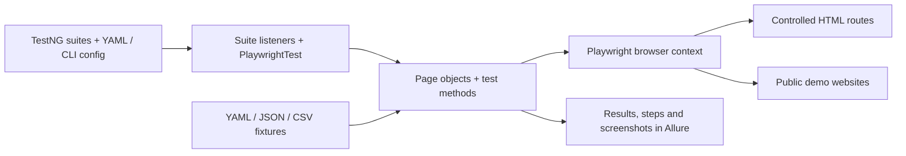
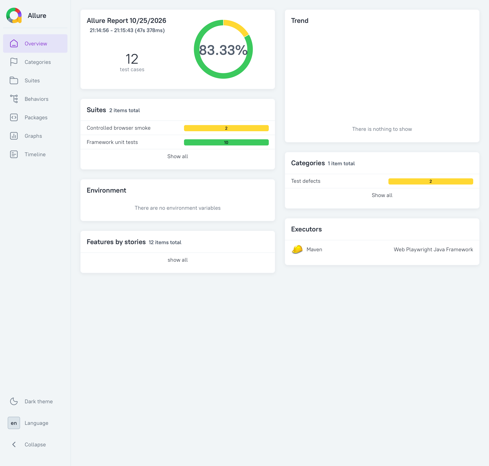

# Playwright Java Accelerator

A Java browser testing framework with Playwright, TestNG and Allure, ready to run.

Use the supplied page objects and examples to build tests for your application.
Run the smoke suite to verify your setup.

[](https://github.com/yashwant-das/qa-java-playwright/actions/workflows/playwright.yml)
[](https://yashwant-das.github.io/qa-java-playwright/)
[](LICENSE)
[](docs/development.md#setup)
[](pom.xml)
[](pom.xml)


## Why it exists

Java teams adopting Playwright still need the infrastructure around browser
automation: a test runner, environment settings, parallel execution, retries,
test data and reports. Playwright Java can work with a [Java test runner](https://playwright.dev/java/docs/test-runners)
such as TestNG or JUnit, but a team
must connect those pieces before it has a reusable testing framework.

This project supplies that starting point for teams that already use Java and
Maven. It brings Playwright's browser API together with TestNG and Allure so you
can focus on your application's tests rather than rebuilding the same setup.
The [background article](https://medium.com/@yashwant-das/accelerate-your-java-ui-testing-with-playwright-introducing-a-modern-robust-framework-83b98e323411)
explains the motivation; the commands and versions here describe this repository.

The framework connects these capabilities:

- **Execution settings without test-code edits:** YAML environments and typed
  command-line overrides select the browser and configure suite parallelism and retries.
- **Browser-state isolation:** Each browser test method gets a fresh context and
  page; thread-local Playwright/browser handles are reused within a worker.
- **Reusable interactions and data:** Page objects keep page actions together;
  cached YAML/JSON/CSV fixtures support shared and environment-specific data.
- **Failure investigation:** Allure collects test results and annotated steps;
  the failure listener attempts screenshots when enabled and an active page is available.
- **A first run without public websites:** Controlled smoke tests check form
  submission and context isolation in a real browser before you try the public examples.

The supplied application examples use public websites and must be replaced for
your application. [Architecture](docs/architecture.md#execution-and-boundaries)
explains lifecycle boundaries, including the current worker-cleanup limitation.

## Architecture



### Project structure

```text
qa-java-playwright/
├── src/test/
│   ├── java/com/qaframework/playwright/
│   │   ├── core/         # Browser and context lifecycle
│   │   ├── config/       # Typed configuration model
│   │   ├── listeners/    # Suite settings, retries and screenshots
│   │   ├── pages/        # Reusable page objects
│   │   ├── testdata/     # Fixture loading and generated data
│   │   ├── util/         # Configuration loading and unit tests
│   │   ├── smoke/        # Controlled browser checks
│   │   └── examples/     # Public-site and data examples
│   └── resources/        # Environments, fixtures, suites and logging
├── config/               # Checkstyle rules
├── scripts/              # Staged Java checks
├── .mvn/wrapper/         # Pinned Maven distribution settings
├── mvnw                  # Maven Wrapper for macOS/Linux
├── mvnw.cmd              # Maven Wrapper for Windows
├── pom.xml               # Dependencies, plugins and Java target
├── docs/                 # Guides and report preview
└── .github/              # CI, report deployment and dependency updates
```

### Tech stack

| Layer | Tool / version | Purpose |
| --- | --- | --- |
| Build | Java 21; Maven 3.10.0 | Compile and run with a pinned build and matching Java target |
| Browser automation | Playwright Java 1.64.0 | Package-matched Chromium, Firefox and WebKit binaries |
| Test runner | TestNG 7.12.0 | Suites, data providers, parallel execution and retry listeners |
| Configuration / data | Jackson 2.22.4 | YAML configuration and YAML/JSON/CSV fixtures |
| Reporting | Allure adapter 2.35.5; Report 2.46.1 | Steps, test results and failure evidence |
| Local gates | Checkstyle 14.3.0; pre-commit 4.7.0 | Java static analysis and staged Markdown/text/config checks |

The [POM](pom.xml), [wrapper properties](.mvn/wrapper/maven-wrapper.properties)
and [hook configuration](.pre-commit-config.yaml) are the version sources of truth.
[Architecture](docs/architecture.md) explains lifecycle boundaries and trade-offs.

## Start a project from this template

1. Copy the repository, change the Maven artifact ID and select a project segment
   under `com.qaframework`; update source paths, imports, suites and logger names together.
2. Set your environment URLs and browser settings in `src/test/resources/config/`.
3. Replace the bundled page objects, fixtures and public examples with tests for
   your application. Public examples contain hard-coded URLs; changing YAML alone
   does not retarget them. Keep the controlled smoke suite for first-run checks.
4. Review the CI matrix, report-publication destination and project links before
   enabling deployment in the copied repository.

## Quickstart

Use JDK 21 with `JAVA_HOME` set. The framework targets Java 21.
Git and internet access are needed for the initial Maven and browser downloads.
Run these commands from the repository root after cloning:

```bash
git clone https://github.com/yashwant-das/qa-java-playwright.git
cd qa-java-playwright
./mvnw test-compile
./mvnw exec:java -Dexec.mainClass=com.microsoft.playwright.CLI -Dexec.args="install chromium"
./mvnw test -DsuiteXmlFile=src/test/resources/suites/smoke.xml -Denvironment=local
```

The smoke suite runs a real headless Chromium browser against controlled HTML.
Expect zero failures and `BUILD SUCCESS`. No credentials or running application
are needed. On Windows use `mvnw.cmd` and quote `-D` arguments in PowerShell.
See [setup](docs/development.md#setup) for JDK selection and platform details.

## Usage

```bash
# Default suite: configuration units and examples, including public websites
./mvnw test -Dbrowser.headless=true

# Selected public-site suite, with retry and parallel listeners
./mvnw test -DsuiteXmlFile=src/test/resources/suites/example-suite.xml -Dbrowser.headless=true

# Generate the Allure report from the most recent run
./mvnw allure:report
```

[Development](docs/development.md) covers browser selection, overrides, reports,
adding tests and troubleshooting. [Examples](docs/examples.md) lists the demos.
The YAML default is headed Chromium; install Firefox or WebKit from the same
Playwright package before selecting them with `-Dbrowser.type`.

## Verification

```bash
./mvnw verify -DsuiteXmlFile=src/test/resources/suites/unit.xml
./mvnw test -DsuiteXmlFile=src/test/resources/suites/smoke.xml -Denvironment=local
```

`verify` compiles the test-only framework, runs configuration unit tests and Java
static analysis. The smoke suite additionally proves real-browser behavior on
controlled pages. The public-site suite exercises Playwright docs, Selenium’s web form, example.com and httpbin.org.
CI runs quality/unit checks on Linux, controlled checks in all three browsers and
public examples on macOS/Windows, plus CodeQL. These are configured checks;
current results and outstanding native-browser failures are recorded in
[Development](docs/development.md#verification-status).
Allure data is written to `target/allure-results/`; the generated HTML lives in
`target/site/allure-maven-plugin/`. CI uploads reports for three days. Successful
trusted `main` runs publish the [macOS report and Windows link](https://yashwant-das.github.io/qa-java-playwright/).



Earlier local report: 10 configuration tests passed and two controlled browser
checks were marked broken (83.33% passing). This screenshot does not represent
the separate successful clean-copy verification or the hosted CI matrix; see
[verification status](docs/development.md#verification-status) for that evidence.
The report badge links to the latest published `main` report.

[Quality gates](docs/development.md#quality-gates-and-hooks) includes Markdown,
text/config checks and pre-commit setup.

## Documentation

- [Development](docs/development.md): setup, configuration, test commands, reports and troubleshooting.
- [Architecture](docs/architecture.md): layout, execution flow, shared layers and boundaries.
- [Examples](docs/examples.md): the public-site demo catalog, kept separate for quick lookup.
- Historical records: [adoption history](docs/superpowers/history/2026-10-25-standards-adoption.md) and [implementation plans](docs/superpowers/plans/); retained for traceability, not current setup instructions.

## License

MIT. See [LICENSE](LICENSE).
