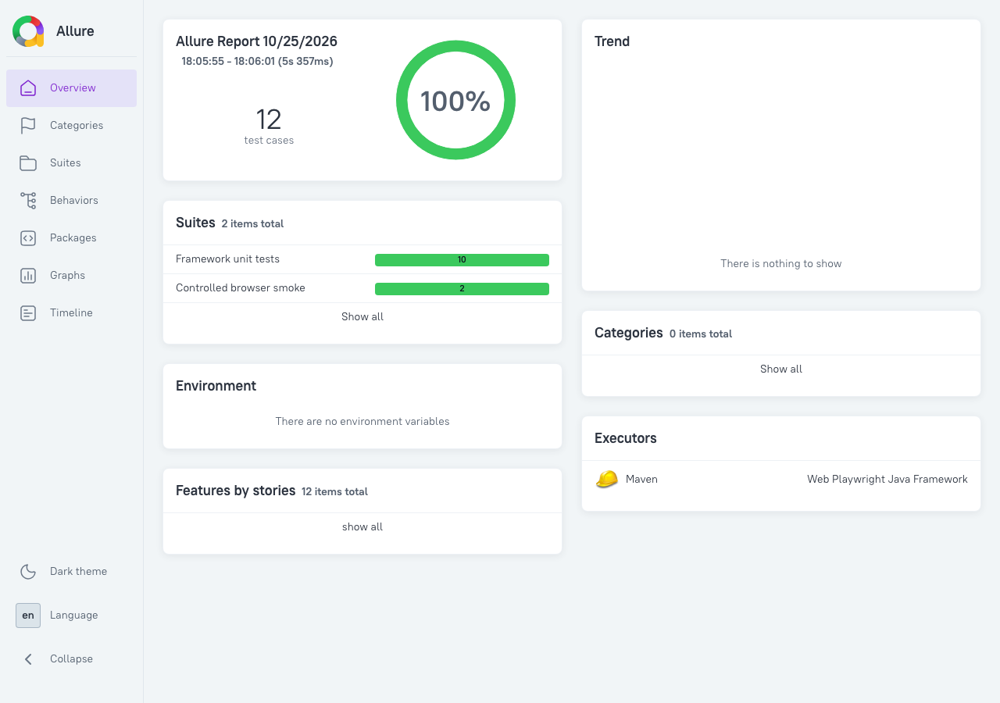
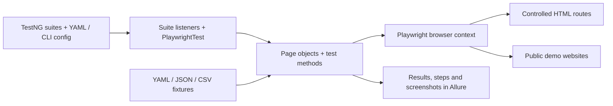

# qa-java-playwright

[](https://github.com/yashwant-das/qa-java-playwright/actions/workflows/playwright.yml)
[](https://yashwant-das.github.io/qa-java-playwright/)
[](LICENSE)


A Java and TestNG starter framework for browser tests, with page objects,
YAML configuration, parallel suites, retries, test data and Allure reports.
Use it as reusable infrastructure or to explore the bundled examples.
The public-site examples depend on websites this repository does not control;
the controlled smoke suite provides a first run without those dependencies.



Local report preview: 10 configuration unit tests and two controlled Chromium
smoke tests. This preview does not represent the full public-site or CI matrix.
The report badge links to the latest published `main` report.

## What this project demonstrates

Browser automation needs more than locators: configuration, isolation, reusable
page objects and useful failure evidence must work together. This starter shows:

- A fresh browser context and page for each test method, with thread-local
  Playwright/browser handles reused within a worker.
- YAML environments and typed `-Dsection.key=value` overrides, including suite
  parallelism and retry behavior applied by TestNG listeners.
- Shared page objects and cached YAML/JSON/CSV fixture loading with an
  environment-specific resource fallback.
- TestNG results and AspectJ steps in Allure reports, with a listener for
  failed-test screenshots and separate report publication from trusted CI runs.
- Separate browser-free configuration units, controlled real-browser smoke
  tests and examples that contact public websites.

## Architecture



### Project structure

```text
src/test/java/com/qaframework/playwright/
  core/, config/, listeners/     browser lifecycle and execution settings
  pages/, testdata/              page objects and fixture loading
  util/, smoke/, examples/       units, controlled checks and public demos
src/test/resources/              environments, fixtures, suites and logging
config/, scripts/               Checkstyle rules and staged Java checks
.mvn/, mvnw, mvnw.cmd            checksum-pinned Maven build
docs/                           development, architecture and example guides
.github/                        CI, report deployment and dependency updates
```

### Tech stack

| Layer | Tool / version | Purpose |
| --- | --- | --- |
| Build | JDK 21, Java 17 target; Maven 3.10.0 | Preserve the existing API/bytecode target with a pinned build |
| Browser automation | Playwright Java 1.64.0 | Package-matched Chromium, Firefox and WebKit binaries |
| Test runner | TestNG 7.12.0 | Suites, data providers, parallel execution and retry listeners |
| Configuration / data | Jackson 2.22.4 | YAML configuration and YAML/JSON/CSV fixtures |
| Reporting | Allure adapter 2.35.5; Report 2.46.1 | Steps, test results and failure evidence |
| Local gates | Checkstyle 14.3.0; pre-commit 4.7.0 | Java static analysis and staged Markdown/text/config checks |

The [POM](pom.xml), [wrapper properties](.mvn/wrapper/maven-wrapper.properties)
and [hook configuration](.pre-commit-config.yaml) are the version sources of truth.
[Architecture](docs/architecture.md) explains lifecycle boundaries and trade-offs.

## Start a project from this template

1. Copy the repository, change the Maven artifact ID and select a project segment
   under `com.qaframework`; update source paths, imports, suites and logger names together.
2. Set your environment URLs and browser settings in `src/test/resources/config/`.
3. Replace the bundled page objects, fixtures and public examples with tests for
   your application. Public examples contain hard-coded URLs; changing YAML alone
   does not retarget them. Keep the controlled smoke suite for first-run checks.
4. Review the CI matrix, report-publication destination and project links before
   enabling deployment in the copied repository.

## Quickstart

Use JDK 21 with `JAVA_HOME` set. The existing Java 17 bytecode target is retained.
Git and internet access are needed for the initial Maven and browser downloads.
Run these commands from the repository root after cloning:

```bash
git clone https://github.com/yashwant-das/qa-java-playwright.git
cd qa-java-playwright
./mvnw test-compile
./mvnw exec:java -Dexec.mainClass=com.microsoft.playwright.CLI -Dexec.args="install chromium"
./mvnw test -DsuiteXmlFile=src/test/resources/suites/smoke.xml -Denvironment=local
```

The smoke suite runs a real headless Chromium browser against controlled HTML.
Expect zero failures and `BUILD SUCCESS`. No credentials or running application
are needed. On Windows use `mvnw.cmd` and quote `-D` arguments in PowerShell.
See [setup](docs/development.md#setup) for JDK selection and platform details.

## Usage

```bash
# All existing examples, against public websites
./mvnw test -Dbrowser.headless=true

# Selected public-site suite, with retry and parallel listeners
./mvnw test -DsuiteXmlFile=src/test/resources/suites/example-suite.xml -Dbrowser.headless=true

# Generate the Allure report from the most recent run
./mvnw allure:report
```

[Development](docs/development.md) covers browser selection, overrides, reports,
adding tests and troubleshooting. [Examples](docs/examples.md) lists the demos.
The YAML default is headed Chromium; install Firefox or WebKit from the same
Playwright package before selecting them with `-Dbrowser.type`.

## Verification

```bash
./mvnw verify -DsuiteXmlFile=src/test/resources/suites/unit.xml
./mvnw test -DsuiteXmlFile=src/test/resources/suites/smoke.xml -Denvironment=local
```

`verify` compiles the test-only framework, runs configuration unit tests and Java
static analysis. The smoke suite additionally proves real-browser behavior on
controlled pages. The public-site suite exercises Playwright docs, Selenium’s web form, example.com and httpbin.org.
CI runs quality/unit checks on Linux, controlled checks in all three browsers and
public examples on macOS/Windows, plus CodeQL. Native-host execution remains
separate evidence; a compile or discovered test count proves neither.
Allure data is written to `target/allure-results/`; the generated HTML lives in
`target/site/allure-maven-plugin/`. CI uploads reports for three days. Successful
trusted `main` runs publish the [macOS report and Windows link](https://yashwant-das.github.io/qa-java-playwright/).

[Quality gates](docs/development.md#quality-gates-and-hooks) includes Markdown,
text/config checks and pre-commit setup.

## Documentation

- [Development](docs/development.md): setup, configuration, test commands, reports and troubleshooting.
- [Architecture](docs/architecture.md): layout, execution flow, shared layers and boundaries.
- [Examples](docs/examples.md): the public-site demo catalog, kept separate for quick lookup.

## License

MIT. See [LICENSE](LICENSE).
