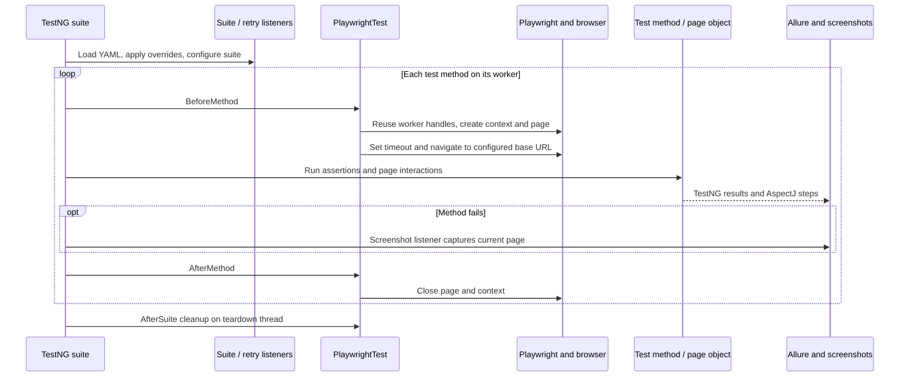

# Architecture

[Project overview](../README.md) · [Development](development.md)

This is a test-only Maven framework. Reusable infrastructure and examples live
under `src/test`; there is no application artifact or `src/main` layer.

## Namespace

Maven group: `com.qaframework`. Base package: `com.qaframework.playwright`.
The neutral owner-approved convention is `com.qaframework.<project>` with a
short descriptive project segment and existing functional subpackages. The
artifact ID remains `qa-java-playwright`; source paths, TestNG suite/listener
names and the framework logger use the same base package.

## Project Structure

```text
pom.xml                           dependency/build sources of truth
mvnw, mvnw.cmd, .mvn/wrapper/     checksum-pinned Maven distribution
config/checkstyle.xml             Java static analysis rules
src/test/java/com/qaframework/playwright/
  core/                           per-thread browser, per-method context lifecycle
  config/                         YAML model
  util/                           configuration loading, overrides and unit tests
  pages/                          base page and Playwright documentation page object
  listeners/                      suite settings, retries, failure screenshots
  testdata/                       fixture loading and generated values
  examples/                       public-site demonstrations
  smoke/                          controlled browser tests
src/test/resources/
  config/                         dev, qa, prod and controlled local environments
  data/                           YAML, JSON and CSV example fixtures
  suites/                         default, example, unit and controlled smoke suites
  logback.xml                     console and rotating file logs
scripts/                          staged Java style adapter
docs/                             development, architecture and example catalog
.github/                          CI, report publication and dependency updates
target/, logs/, .allure/           ignored run/build output
```

## Framework Architecture

### Core Components

**PlaywrightTest** (`core/PlaywrightTest.java`):

- Base test class with browser setup/teardown
- Provides `getCurrentPage()` method for test access
- Handles browser lifecycle management

**ConfigReader** (`util/ConfigReader.java`):

- Singleton pattern for configuration loading
- Loads YAML configuration files
- Applies `-D` system property overrides to the loaded values
- Provides typed access to configuration settings

**TestDataManager** (`testdata/TestDataManager.java`):

- Centralized test data loading from YAML, JSON, CSV
- Path-based value access using dot notation
- Environment-specific data support

**ScreenshotListener** (`listeners/ScreenshotListener.java`):

- Automatic screenshot capture on test failure
- Allure report integration
- Full-page screenshot support

**RetryAnalyzer** (`listeners/RetryAnalyzer.java`):

- Configurable test retry mechanism
- Tracks retry attempts per test
- Configurable delay between retries

**BasePage** (`pages/BasePage.java`):

- Common page object methods (title, URL, wait for load)
- Playwright page wrapper

## Page Object Model

The framework follows the Page Object Model (POM) design pattern for better maintainability and code reusability.

### Base Page

All page objects extend `BasePage`, which provides common functionality:

```java
public abstract class BasePage {
    protected final Page page;

    public BasePage(Page page) {
        this.page = page;
    }

    // Common methods available to all page objects
    public String getTitle() { /* ... */ }
    public String getCurrentUrl() { /* ... */ }
    public BasePage waitForPageLoad() { /* ... */ }
}
```

### Creating a Page Object

```java
public class PlaywrightDocsPage extends BasePage {
    private final Locator getStartedButton;
    private final Locator search;
    private final Locator javaLink;

    public PlaywrightDocsPage(Page page) {
        super(page);
        this.getStartedButton = page.getByRole(AriaRole.LINK,
            new Page.GetByRoleOptions().setName("Get started"));
        // The label includes the platform's shortcut key, so match the prefix only
        this.search = page.getByRole(AriaRole.BUTTON,
            new Page.GetByRoleOptions().setName(Pattern.compile("^Search")));
        this.javaLink = page.locator("a[href='/java/']");
    }

    @Step("Navigate to Playwright documentation")
    public PlaywrightDocsPage navigate() {
        page.navigate("https://playwright.dev/java/");
        return this;
    }

    @Step("Click Get Started button")
    public PlaywrightDocsPage clickGetStarted() {
        getStartedButton.click();
        page.waitForURL("**/docs/intro**");
        return this;
    }

    @Step("Open search dialog")
    public PlaywrightDocsPage openSearch() {
        search.click();
        return this;
    }
}
```

### Creating a Test Class

```java
@Epic("Web Playwright Java Framework")
@Feature("Playwright Documentation Navigation")
public class PlaywrightDocsNavigationTest extends PlaywrightTest {

    @Test(description = "Verify homepage navigation and Get Started button", groups = "smoke")
    @Severity(SeverityLevel.BLOCKER)
    @Story("Homepage Navigation")
    public void testHomePageNavigation() {
        getCurrentPage().ifPresent(page -> {
            PlaywrightDocsPage docsPage = new PlaywrightDocsPage(page);

            docsPage.navigate()
                    .clickGetStarted();

            assertThat(docsPage.getCurrentUrl())
                    .contains("/docs/intro");
        });
    }
}
```

## Execution and boundaries



TestNG loads a suite, then `TestConfigurationListener` loads the selected YAML
configuration and applies parallel settings. `RetryListener` installs retry
behavior. Each `PlaywrightTest` method gets a new context and page; browser and
Playwright handles are held in thread locals. Suite teardown closes handles
visible to its executing thread; this is not a guarantee that another worker’s
thread-local handles have been closed.
Page objects wrap locators and navigation; assertions belong in tests.

`ConfigReader` applies properties only to existing YAML paths. Its singleton is
initialized once per JVM, so select the environment before starting Maven.
`TestDataManager` loads environment-specific classpath fixtures, falls back to
the common data directory and caches parsed data. Fixture values are examples,
not credentials for real services.

The public examples contact playwright.dev, selenium.dev and example.com. Their
availability and page structure are outside this repository’s control. The local
smoke suite instead serves HTML through Playwright routing and uses `about:blank`
for initial setup; it exercises a real browser without public-site dependencies.

Allure receives TestNG results and AspectJ `@Step` events. ScreenshotListener
attaches failed-test screenshots. Generated results, screenshots and logs are
ignored; report publication is a separate trusted-branch CI job.

## Build sources of truth

- [POM](../pom.xml): Java target, pinned dependencies, plugins and quality gates.
- [Wrapper properties](../.mvn/wrapper/maven-wrapper.properties): Maven distribution and checksum.
- [Suite files](../src/test/resources/suites/): offline, controlled and public test selections.
- [Workflow](../.github/workflows/playwright.yml): supported runner matrix and report publication.
